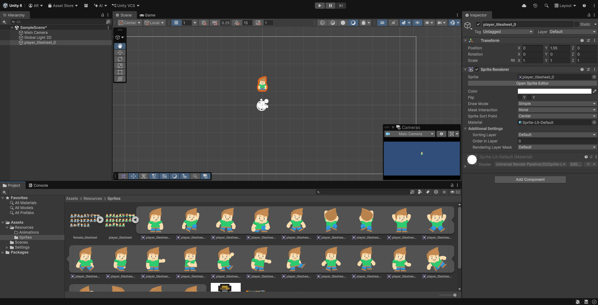
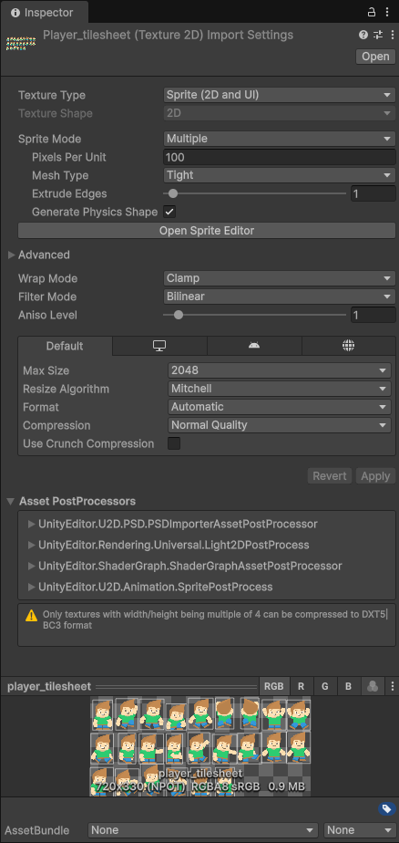

# FDV-2DSprites

*Fundamentos del Desarrollo de Videojuegos*' assignment: 2D sprites exercises.


> Create a new Unity project with the 2D preset. You'll need to download the "2D Resources" folder to follow the exercises.
> - **Sprite Atlas**: an image that can be divided into multiple other images with game assets: animated sequences for characters, props, weapons, etc. Loading many resources in a single image is more efficient that loading each individual image by themselves.

## Table of contents
1. [Task 1](#task-1)
2. [Task 2](#task-2)
3. [Task 3](#task-3)
4. [Task 4](#task-4)
5. [Task 5](#task-5)
6. [Task 6](#task-6)
7. [Task 7](#task-7)
8. [Task 8](#task-8)

## Task 1
> Add the Sprite Atlas of the character to the project. Configure the sprite as `Multiple` so that it can get subdivided for the animations. Add one of the images to the scene.



I added all the provided sprites to the [Assets/Resources/Sprites](Assets/Resources/Sprites) folder. Unity was smart enough to automatically detect the tilesheets and set them to "Multiple".




## Task 2

> Create a 2D object, then add an animation by dragging a set of images into it. Add the "Walk Down" animation to the character. Add another image, and create another animation. This way, Unity creates an `Animation` object, and the first time it also adds an `Animator Controller` object.

Following these instructions the "Player" Animator Controller and both animations ("Idle", "WalkDown") were created. I placed them inside [Assets/Resources/Animations](Assets/Resources/Animations/).


## Task 3

> Write scripts to control the character. Initially, we'll make a version without jumping. Add the necessary scripts to move it onscreen. In this case we'll only need to move the (X, Y) coordinates. We achieve the left-right movement by modifying `transform.position(x, y)`. For that, we can use `transform.Translate(advance, 0)`.\
Control the movement by keyboard: the advance is produced if the player has pressed the left or right arrows.\
You'll need the following instructions:
> ```c#
> float horizontalInput = Input.GetAxis("Horizontal");
> Vector2 movement = new Vector2(horizontalInput, 0f);
> transform.Translate(movement * speed * Time.deltaTime);
> ```


For this task, [the script](Assets/Resources/Scripts/Task3_Player.cs) uses the snippet provided by the task statement:
```c#
using UnityEngine;

public class Task3_Player : MonoBehaviour
{
    public float speed = 1.0f;
    private Vector2 movement;

    void Update()
    {
        float horizontalInput = Input.GetAxis("Horizontal");
        movement.Set(horizontalInput, 0f);
        transform.Translate(speed * Time.deltaTime * movement);
    }
}
```

## Task 4

> We'll also need to orient the sprite towards the walk direction, and we can achieve that by using the `Flip` property on the X axis based on wether we're moving left (negative) or right (positive): \
> - Obtain the `SpriteRenderer` component to modify the sprite. You'll only have to do it once.
> - Check the direction of the movement using the value of `horizontalInput`.
> - Use an `if` condition to check if the character moves right.
> - Use an `else if` condition to check if the character moves left.
> ```c#
> SpriteRenderer spriteRenderer;
> spriteRenderer.flipX;
>   ```


Using the instructions above, I modified Task 3's script to include the horizontal flipping based on the direction of movement.

```c#
using UnityEngine;

[RequireComponent (typeof(SpriteRenderer))]
public class Task4_Player : MonoBehaviour
{
    public float speed = 1.0f;
    private Vector2 movement;
    private SpriteRenderer spriteRenderer;

    void Start()
    {
        spriteRenderer = GetComponent<SpriteRenderer>();
    }

    void Update()
    {
        float horizontalInput = Input.GetAxis("Horizontal");
        movement.Set(horizontalInput, 0f);
        transform.Translate(speed * Time.deltaTime * movement);
        if (horizontalInput > 0) { // facing right
            spriteRenderer.flipX = false;
        } else if (horizontalInput < 0) { // facing left
            spriteRenderer.flipX = true;
        }
    }
}
```

## Task 5

> Create the character's animations: for each animation we want to add to an object, we select the collection of sprites that form the animation and we drag it to the object. We'll add all the animations to the character. The `Animation Controller` component manages them at runtime.\
> With the animation selected, we can drag the player object and checkout the animations.\
> The `Animator` tab gives us a graphical interface that allows us to visually define the **state machine** that controls the animation. By default, the initial state (**Entry**) moves to the **Idle** animation. The transitions can be controlled by parameters that will allow us to define scripts that use them based on their values.
> ```c#
> private Animator animator;
> animator = GetComponent<Animator>();
> animator.SetBool("isWalking", true);
> ```
> Create a script in which the character changes animation after walking a certain distance. For that, you have to:
> - Declare a variable to update on each frame the distance travelled.
> - Declare a state machine parameter whose value change triggers the transition to another animation.
> - Obtain a reference to the `Animator`: you'll only have to access it once to be able to use it in the code. Obtain a reference in your script to control the changes in animations.
> - On each frame, compute how much the character has moved since the original position.
> - If the total distance travelled is over the activation distance, your script must indicate the `Animator` to use another animation.
> - Compute the distance between the current position and the original resting position: `distanceThisFrame = Vector3.Distance(firstPosition, transform.position);`.


Following the instructions, I modified the Animator's state machine so that it now includes an `isWalking` boolean parameter, and defines transitions between the `Idle` and `MoveDown` parameters based on it:


I added the Animator manipulation logic to the previous task's Player script:
```c#
using UnityEngine;

[RequireComponent (typeof(SpriteRenderer), typeof(Animator))]
public class Task5_Player : MonoBehaviour
{
    public float speed = 1.0f;
    public float minWalkingDistance = 0.001f;
    private Vector2 movement;
    private SpriteRenderer spriteRenderer;
    private Animator animator;
    private Vector3 restingPosition;

    void Start()
    {
        spriteRenderer = GetComponent<SpriteRenderer>();
        animator = GetComponent<Animator>();
        restingPosition = transform.position;
    }

    void Update()
    {
        float horizontalInput = Input.GetAxis("Horizontal");
        movement.Set(horizontalInput, 0f);
        transform.Translate(speed * Time.deltaTime * movement);
        if (horizontalInput > 0) { // facing right
            spriteRenderer.flipX = false;
        } else if (horizontalInput < 0) { // facing left
            spriteRenderer.flipX = true;
        }
        float distanceThisFrame = Vector3.Distance(restingPosition, transform.position);
        if (distanceThisFrame >= minWalkingDistance) {
            animator.SetBool("isWalking", true);
        } else {
            animator.SetBool("isWalking", false);
        }
        restingPosition = transform.position;
    }
}
```
The new logic revolves around checking against a minimum travel distance between frames for the animation change to trigger.

## Task 6

> Experiment with the concept of PPU (*Pixels Per Unit*): open the Sprite Editor and note down the size in pixels of one of the character sprites. In the Atlas inspector, find the PPU value. Which is the default? Calculate how big in units the character will be.\
> Check your computation: add a `BoxCollider2D`, then check its `Size` property; or compare it against the grid in the Scene view (each cell is 1 Unit).\
> Change the PPU to 16, 32 and 100 (pressing "Apply" each time). Has the image changed? What changed then?
> Choose a PPU so that the character is between 1 and 2 units tall. What value did you choose? Why?

By going back to [Task 1](#task-1), we'll discover that the default PPU value is 100, and that the first image in our Atlas is 65x98 (Width x Height). We know that a sprite's size in units $spriteSize_u$ is computed as:

$$
spriteSize_u = \frac{spriteSize_{px}}{PPU_{px}} 
$$

Therefore, by plugging in our $PPU = 100$, we get that our sprite's size in units is 0.65x0.98. If we add the collider to check:


Changing the PPU changes the size of the image **in the scene**:

| $PPU = 16$ | $PPU = 32$ | $PPU = 100$ |
|:------------:|:------------:|:-------------:|
|  |  | 

This is coherent with the formula above, since smaller PPU values make the image bigger.

To make the character between 1 and 2 units tall (say, for example, 1.6 units tall), we'd just have to solve for the new PPU value:

$$
PPU_{px} = \frac{spriteSize_{px}}{spriteSize_u};
$$

$$
PPU_{px} = \frac{98}{1.6} = 61.25
$$

This way, our new PPU would be 61.25.

## Task 7

> Add a second object to the scene with another sprite from the resources folder, and add a different PPU from that of the character. Adjust the scale of its Transform so that both objects have a similar size onscreen. Zoom in on the Game view and compare the pixel size of both sprites. If the pixels are blurry, select the Atlas and set the Filter Mode to "Point (no filter)" and the Compression to "None". It is the configuration needed for any pixel art game. Do the pixels of both sprites have the same size? What rule do all sprites of the game have to follow for this to not happen?

I added a ship, and set its Atlas' PPU to 25. When placing it side by side with the player, it appears significantly bigger:


The ship's pixels are four times bigger than the player's. To avoid this we should just set the same PPU value to all the sprites in the game.

## Task 8

> Select the Main Camera and check that the Projection is Orthographic. Note down its Size. Before checking it, calculate how many vertical units are visible. Check the computation: place two objects, one at `y = +size` and another at `y = -size`. Are they right at the borders of the Game view?\
> In the resolution dropdown from the Game view, change between 16:9, 4:3 and a paronamic resolution (like 2560x1080). Observe what changes and what doesn't.\
> Change the Size to 2, then 10. How does the size of the character onscreen change? When changing the aspect ratio, which dimension is fixed and which changes?\
> With Size = 5, calculate the visible width in 16:9 and 4:3. If two players use different monitors, do they see the same amount of level? In which type of game would this be an issue?

With the player at y = +size, and the boat at y = -size, they are both right at the borders of the Game view.

|Size\Aspect ratio| 4:3 | 16:9 | 21:9 |
|:---:|:----------:|:---------:|:------------:|
| 2 |  |  |  |
| 5 |  |  |  |
| 10 |  |  |  |

Note: upon camera Size changes, the positions of both objects were changed to match the new values. We can draw a few conclusions:
- The size of the camera is inversely proportional to the apparent size of objects onscreen: the smaller the camera, the bigger the objects.
- The vertical distance in units is kept when comparing resolutions. What ends up changing is the width, so as a result widescreen users end up seeing more of the scene. With Size = 5, all aspect ratios show a total of 10 units vertically, but:
    - 4:3 users see $10 \cdot \frac{4}{3} = 13.\overline{3}$ units horizontally.
    - 16:9 users see $10 \cdot \frac{16}{9} = 17.\overline{7}$ units horizontally.
    - 21:9 users see $10 \cdot \frac{21}{9} = 23.\overline{3}$ units horizontally.

In multiplayer games this could give some players an unfair advantage, and games would have to overcome this issue.